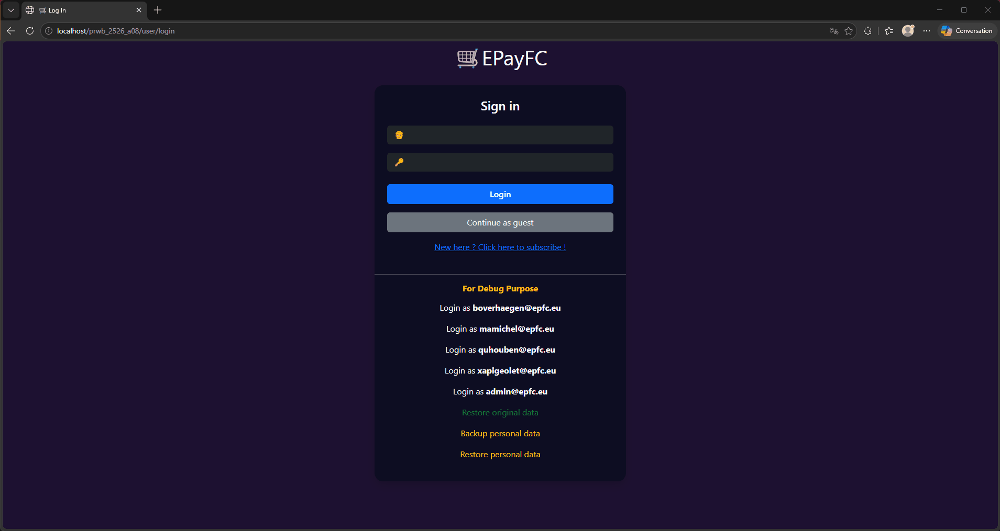

# 🏷️ EPayFC — Full-Stack Online Auction & Bidding Platform

[](https://www.php.net/)
[](https://www.mysql.com/)
[](https://getbootstrap.com/)
[](#-software-architecture)
[](#-security--data-integrity)

> **Full-stack web platform for dynamic online auctions, classified item management, and direct sales, built with a custom-engineered PHP MVC framework, robust relational persistence (MySQL/MariaDB), role-based authorization, and asynchronous client-side interactions.**

> This project was carried out as part of the course entitled **« Projet de développement web »** (EPFC Brussels), where we learned how to develop on the server side in PHP and on the client side in HTML, JavaScript, and CSS, using AJAX requests to ensure the dynamism of the interface.
---

## 🎯 Project Overview & Core Features

**EPayFC** is a modular academic web platform designed to manage the complete lifecycle of competitive item auctions and direct sales ("Buy It Now"). 

Built around a **custom lightweight Model-View-Controller (MVC) core**, the platform demonstrates rigorous separation of concerns, secure server-side session handling, input sanitization, and structured data persistence.

### ✨ Comprehensive Features List

#### 🛒 1. Catalog & Bidding Experience (Buyers / Guests)
* **Instant Multicriteria Search (AJAX):** Asynchronous live filtering by keywords (matching titles, descriptions, or seller usernames) and category filters without page reloads.
* **Dual & Hybrid Selling Models:**
  * **Standard Auctions:** Place incremental bids validated in real time.
  * **Direct Sales ("Buy It Now"):** Instant item acquisition at a fixed price.
  * **Hybrid Listings:** Bidding auctions featuring an optional buyout ceiling threshold (`buy_now_price`).
* **Bid Tracking & Visual Indicators:** Contextual badges dynamically computed for authenticated buyers (`Highest Bidder`, `Bidder`, `Auction`, `Buy Now`).
* **URL Search State Preservation:** Query terms and selected filters are compressed and URL-safe encoded (`EncoderDecoder`), ensuring seamless back-and-forth navigation without losing search state.
* **Guest Access:** Transparent catalog browsing and item inspection for non-authenticated visitors, with bidding restricted to members.

#### 📦 2. Selling & Listing Management (Sellers)
* **Offer Creation (`item/add`):**
  * Configurable duration (1 to 365 days) and pricing options (Auction, Direct Sale, or Auction + Buy Now).
  * Strict category allocation (up to 3 categories per listing, with modal warning).
  * Real-time server-side title uniqueness verification (`item/check_title_unicity_service`) on blur.
* **Listing Edition & Safeguards:** Edit listing details prior to receiving any bids. Automatic detection of uncommitted changes (`is_pristine`) prompting an "Unsaved Changes" modal before leaving.
* **Cascading Removal:** Complete deletion of an item along with its associated bids, category links, and physical uploaded files.
* **Interactive Media Gallery (`item/manage_images`):**
  * Multi-image uploads (JPG, PNG, GIF, WebP) with automatic server-side conversion into 1080p full images and 360p thumbnails (`ImageUtils`).
  * Reorder picture display priority via drag-and-drop (jQuery UI Sortable) persisted asynchronously.

#### 👤 3. Account & Profile Customization
* **Authentication & RBAC:** Secure sign-up, sign-in, and session lifecycle with Bcrypt password hashing and role enforcement (`user` vs `admin`).
* **Profile Customization (`user/edit_profile`):** Update personal details, username unicity check, and Belgian IBAN validation via strict regex for payouts.
* **Profile Picture Management (`user/manage_profile_picture`):** Upload, automatic scaling, or removal of user avatars with directory clean-up.
* **Security Settings:** Update account password with strict requirement checks (8–16 characters, uppercase, lowercase, numbers, and special characters) and current password verification.
* **Activity Dashboards:**
  * **Completed Sales:** Track total revenue, average sale ticket, and identify the most loyal recurring bidder.
  * **Purchases:** Overview of secured items, total spent, and top seller statistics.

#### ⚙️ 4. Administration & Developer Tools
* **Taxonomy Management (`category/manage` - Admin Only):** Add, rename (inline edit on blur), and reorder categories via drag-and-drop with instant AJAX priority recalculation. Empty categories can be safely deleted.
* **Time-Warp Engine (`AppTime`):** Session-based time offset controls (`+1h`, `+1d`, `+1w`, `Reset`) allowing developers to test auction deadlines and automated status shifts deterministically without touching the server system clock.
* **Data Installer & Reset (`setup`):** One-click automated database schema re-creation, seed data loading, upload directory restoration, and automatic date recalibration relative to current simulation time.

---

## 🎬 Feature Highlights

| Buyer Experience (Live Search & Bidding) | Seller Experience (Image Ordering & Item Removal) |
| :---: | :---: |
|  |  |
| *Real-time catalog search and placing a bid on an active listing.* | *Reordering item pictures via drag-and-drop and cascading item deletion.* |

---

## 🏗️ Software Architecture

The codebase enforces a clean separation of concerns, decoupling domain entities, routing, security layers, and presentation:

```text
EPayFC/
├── config/             # System parameters and business rule definitions
├── controller/         # Request handling & orchestration (Item, User, Category, Time, Setup)
├── framework/          # Autonomous MVC Core (Router, Controller, Model, View, Tools)
├── model/              # Domain entities & database persistence (Item, Bid, User, Category, Picture)
├── utils/              # Specialized utilities (AppTime, ImageUtils, Sanitization)
├── view/               # Modular PHP presentation templates and partials
├── scripts/            # Asynchronous JavaScript handlers & jQuery AJAX modules
├── css/                # Custom stylesheets and localized Bootstrap 5.3 components
├── database/           # Relational schema migrations and database fixture dumps
└── uploads/            # Dynamic media storage segregated by entity ID
```
--- 

## 🔒 Security & Data Integrity

* **SQL Injection Immunity:** 100% of database interactions are abstracted via PDO using parameterized prepared statements.
* **Role-Based Access Control (RBAC):** Strict permission separation between standard users and administrators. Administrative routes and JSON endpoints are safeguarded on the server side with HTTP 403 responses.
* **Directory Cloaking & Defense-in-Depth:** Hierarchical `.htaccess` configurations enforce `Deny from all` on core directories (`/config`, `/controller`, `/framework`, `/model`, `/utils`, `/view`, `/database`), preventing unauthorized direct HTTP script execution.
* **Input Sanitization & XSS Neutralization:** Centralized data-cleaning pipelines validate and sanitize input streams prior to reaching controller and model logic.
* **Secure File Upload Pipeline:** Strict server-side MIME type verification, dimension checks, cryptographic file renaming, and execution isolation for all uploaded media.
* **Password Hashing:** User authentication leverages modern cryptographic algorithms (`password_hash` with Bcrypt).

---

## 🛠️ Tech Stack

* **Backend:** PHP 8.2+ (OOP, PDO, GD Extension)
* **Database:** MySQL 8.0 / MariaDB 10.5+
* **Frontend:** HTML5, CSS3, Bootstrap 5.3, JavaScript (ES6+), jQuery, jQuery UI
* **Web Server:** Apache 
